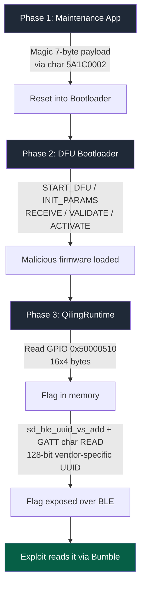

# HITCON CTF — "My IOT homework_new folder (1) _ver.114514(final)"
Author: Lorenzo Iwao Akizuki
Date: October 2026
Category: Exploit Development · Firmware / Embedded · BLE
Platform: HITCON CTF
Target: yaju-os.chal.hitconctf.com:6402
Status: Completed

**Category:** Exploit Development · Firmware / Embedded · BLE
**Target:** `yaju-os.chal.hitconctf.com:6402`
**Result:** Flag obtained via firmware reversing + Nordic DFU exploitation + custom malicious firmware.

> **Disclaimer:** This writeup and exploit were developed against an official HITCON CTF competition instance, run for educational purposes within an authorized security competition. Do not run this code against systems you do not own or do not have explicit permission to test.

## Summary

The server emulates an **nRF51 (ARM Cortex-M) microcontroller** using **Qiling** + **Rootcanal** for Bluetooth Low Energy. The challenge requires chaining three phases:

1. Send a "magic" command, discovered via reverse engineering, to jump into the bootloader.
2. Upload a custom firmware image using the **legacy Nordic DFU protocol**.
3. That firmware reads the flag from a virtual GPIO and exposes it through a BLE characteristic.

## Flow diagram



## Phase 1 — Reversing and jumping to the bootloader

The firmware exposes a writable GATT service (`5A1C0002-...`). The `command_handler` function (`0x1b008`) validates a 7-byte payload with a per-byte XOR against two tables (`expected`, `key`) extracted from the firmware image, followed by a bit rotation indexed by position.

Reversing the formula yields the magic payload — a reference to the "114514" meme — which, once written, triggers the jump to the bootloader.

→ See `exploit.py::BOOTLOADER_PAYLOAD`.

## Phase 2 — DFU protocol (legacy Nordic)

The bootloader exposes **Control Point** (`00001531-...`, NOTIFY/WRITE) and **Packet** (`00001532-...`, WRITE_WITHOUT_RESPONSE). The full sequence (START_DFU → INIT_PARAMS → RECEIVE → VALIDATE → ACTIVATE) and the 14-byte init packet format (CRC16-CCITT, Nordic flavor) are implemented in `exploit.py`.

**Key gotcha:** image sizes are sent over *Packet*, not *Control Point* — a common mistake that silently breaks the sequence.

## Phase 3 — Malicious firmware

ARM Thumb firmware assembled with Keystone (`firmware.asm`) that:

1. Reads 64 bytes of flag data from the GPIO at `0x50000510`.
2. Registers a 128-bit base UUID via `sd_ble_uuid_vs_add` (SVC `0x63`).
3. Publishes a GATT service with a readable characteristic pointing at the flag buffer.

**Important gotcha:** the server validates UUIDs with Python's `uuid.UUID()`, which **rejects 16-bit UUIDs**. You must use 128-bit vendor-specific UUIDs, or the characteristic simply never shows up — with no visible error.

## Lessons learned

- Firmware reversing with Capstone + Qiling emulation lets you reverse-engineer proprietary protocols with no documentation.
- Nordic's legacy DFU protocol has several implementation quirks (write ordering, expected notifications) that only surface once you instrument the runtime locally.
- Validate assumptions against the remote server, not just the local emulator — the 16-bit UUID bug only showed up there.

## Running it

```bash
pip install -r requirements.txt
python exploit.py --host yaju-os.chal.hitconctf.com --port 6402
```

## Repo layout

```
iot-homework-writeup/
├── README.md         # this file
├── exploit.py         # full exploit script (Bumble), with CLI args
├── firmware.asm        # malicious firmware (ARM Thumb, assembled with Keystone)
├── requirements.txt     # pinned dependencies
└── LICENSE            # MIT
```

## Flag

```
hitcon{0m43 y4rim4su n3 sugi}
```

## Example run

```
$ python exploit.py --host yaju-os.chal.hitconctf.com --port 6402
[*] Firmware assembled: 164 bytes
[*] Init packet: ffffffff00000100008012ab
[*] Sending magic payload to 5A1C0002-7C5D-4C8D-942C-A786C1D58B6D
[*] START_DFU...
    [DFU] Notify: 100101
[*] INIT_PARAMS...
    [DFU] Notify: 100201
[*] RECEIVE...
    [DFU] Notify: 100301
[*] VALIDATE...
    [DFU] Notify: 100401
[*] ACTIVATE...
[*] 5A1C1002-...: hitcon{0m43 y4rim4su n3 sugi}

🚩 FLAG: hitcon{0m43 y4rim4su n3 sugi}
```

*(Placeholder values for the init packet hex above — replace with the actual run output if you want a byte-exact log.)*
